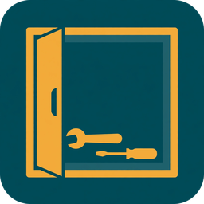
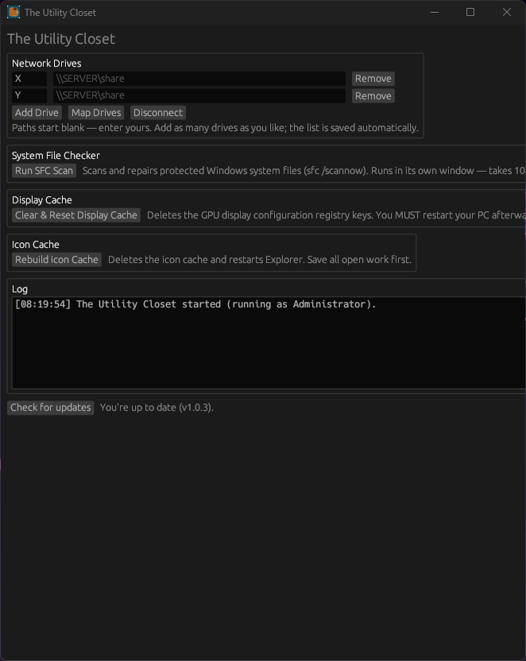

# The Utility Closet

<p align="center">
  
</p>

An all-in-one Windows maintenance app: network drive mapping, System File
Checker, display cache reset, and icon cache rebuild — in one small window,
no bloat.

Built with [Rust](https://www.rust-lang.org/) and [egui](https://www.egui.rs/).
Distributed as an installer, no dependencies, no console window. Requests administrator
rights on launch (every tool needs them).

## Screenshot

<p align="center">
  
  <br><em>Everything in one small window — drives, SFC, both cache tools, and a live log.</em>
</p>

## Download

Grab the latest `UtilityCloset-Setup-vX.Y.Z.exe` installer from
[Releases](https://github.com/shawnrodis/UtilityCloset/releases) and run it —
requires administrator (the app needs elevation for SFC/registry work).
Installs to `%PROGRAMFILES%\UtilityCloset` with Start Menu and desktop
shortcuts plus an uninstaller. (Building from source is optional; instructions
below.)

## Features

- **Network Drives** — map/unmap drives with `net use`, output shown live in
  the log. Starts with one blank X row, paths start blank; press Add Drive
  for more, up to 6 drives. The list is saved to `UtilityCloset.ini`
  next to the exe and restored on launch.
- **System File Checker** — launches `sfc /scannow` in its own window.
- **DISM — Windows Image Repair** — three buttons, each in its own window:
  Check Health (quick check for a flagged-corrupt image), Scan Health
  (deeper scan for component store damage), and Restore Health (repairs
  the image, downloading replacement files via Windows Update — takes
  10-20+ minutes and needs an internet connection for the download part).
  This is the same repair as the PowerShell `Repair-WindowsImage -Online
  -RestoreHealth` alternative.
- **Display Cache** — deletes the GPU display-configuration registry keys
  (`GraphicsDrivers\{Configuration, Connectivity, ScaleFactors}`). Restart
  required afterwards.
- **Icon Cache** — clears the icon cache, restarts Explorer, offers a reboot.
- **Forced Shutdown** — a toggle that changes what Windows' own Shut down /
  Restart buttons do: on, Windows ends blocking apps itself after about
  2 seconds instead of showing the "apps are preventing shutdown" warning;
  off, the warning comes back. Applies immediately, no reboot needed.
  Warning: with it on, unsaved work in open apps can be lost.
- **Windows Welcome Experience** — a toggle that turns off the white
  post-update setup screen ("Let's finish setting up your device" /
  "Get even more out of Windows") with its OneDrive backup and
  Microsoft 365 prompts. Note: Microsoft can reintroduce new prompts in
  major updates, so this suppresses the current screen rather than
  guaranteeing it never returns in any future form.
- **Always Show All Tray Icons** — a toggle that stops Windows hiding
  system-tray icons in the overflow menu behind the up-arrow, so every
  notification-area icon stays visible on the taskbar. Applying it
  restarts Explorer (the taskbar briefly disappears and comes back).
  Caveat: on Windows 11 some apps' per-app overflow settings can still
  override this, so it is the closest thing to a global switch, not a
  guaranteed override for every app.
- **Windows Annoyances Reset to defaults** — a button at the bottom of
  the Windows Annoyances section that restores Windows' own defaults:
  forced shutdown OFF, welcome experience ON (the post-update setup
  screen is allowed again — that is the Windows default, even though
  you will usually have it off), and show all tray icons OFF. If the
  tray-icons state changed, Explorer restarts once so the taskbar
  picks it up.
- Shortcuts are named "Utility Closet" (not "The Utility Closet") on the
  desktop and in the Start Menu; installing v1.0.7 also removes the old
  "The Utility Closet" shortcuts.
- Follows the Windows light/dark app theme. Custom closet icon.

## Build from source

On Windows (install Rust via [rustup](https://rustup.rs/) first):

```powershell
cargo build --release
```

Cross-compile from Linux:

```bash
# mingw-w64 provides the linker and windres
sudo apt install mingw-w64
rustup target add x86_64-pc-windows-gnu
# make sure a `windres` binary is on PATH, e.g.:
#   sudo ln -s /usr/bin/x86_64-w64-mingw32-windres /usr/local/bin/windres
cargo build --release --target x86_64-pc-windows-gnu
```

The build script compiles `assets/UtilityCloset.rc` with windres and links the
resulting object directly, embedding the exe icon and the
`requireAdministrator` manifest.

## Project layout

```
UtilityCloset/
├── src/main.rs            # the whole app (egui)
├── build.rs               # embeds icon + admin manifest via windres
├── assets/
│   ├── UtilityCloset.ico        # exe / window icon
│   ├── UtilityCloset.manifest   # requireAdministrator manifest
│   └── icon.png                 # runtime window icon (from the .ico)
└── Cargo.toml
```

## License

GPL-3.0 — see [LICENSE](LICENSE). Copyright (c) 2026 Shawn Rodis.
