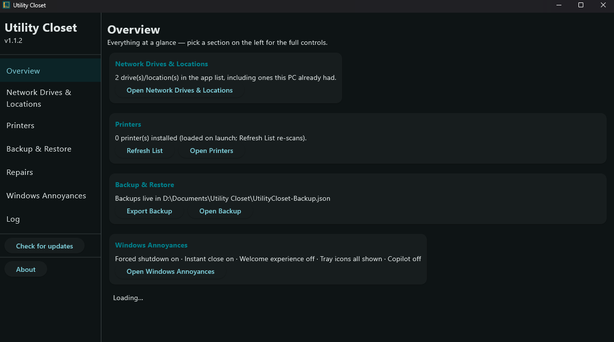
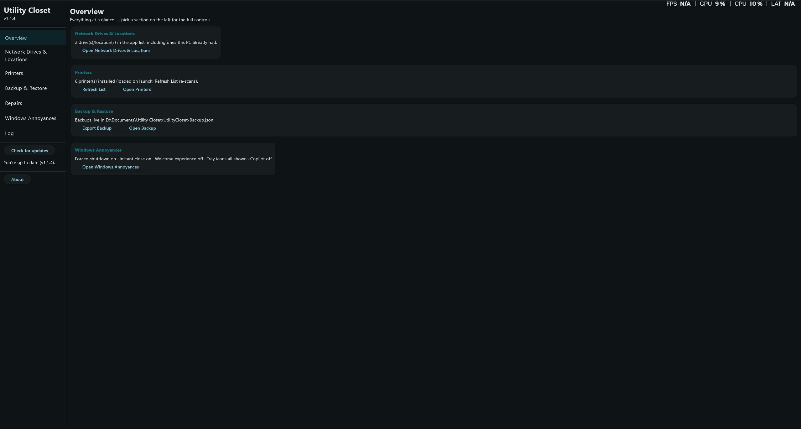
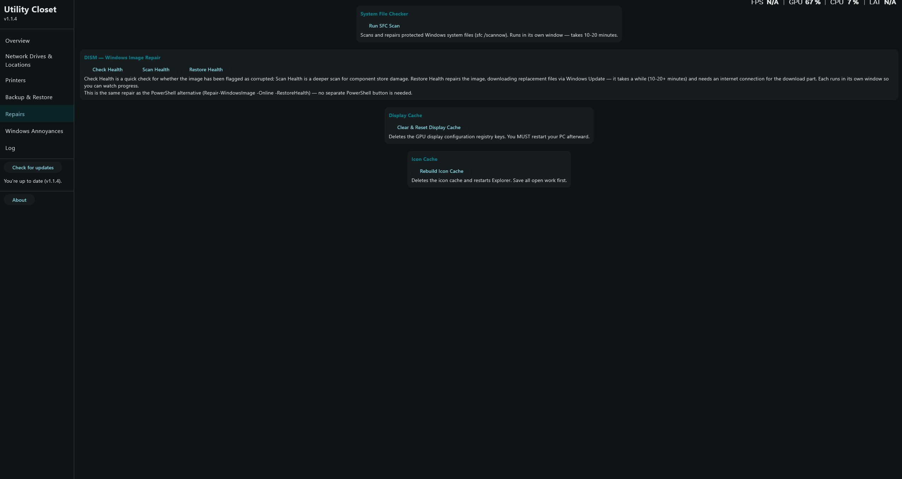
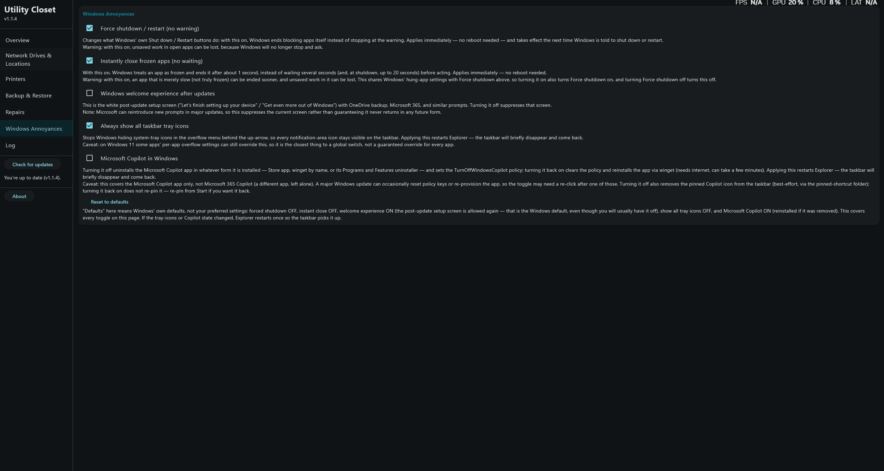

# The Utility Closet

An all-in-one Windows maintenance app: network drive mapping, bulk printer
setup, backup and restore of drives, printers and monitor layout, System
File Checker and Windows image repair, display cache reset, and icon cache
rebuild — plus switches for common Windows annoyances — in one window,
no bloat, no command line needed.

Built with [Rust](https://www.rust-lang.org/) (core logic) and
[Flutter](https://flutter.dev/) (UI), RustDesk-style: the Rust core
handles drives, printers, repairs, annoyances, and backup/restore, and
the Flutter UI calls it through a plain C ABI. No egui — the egui
version is preserved on the `egui-legacy` branch.

Distributed as an installer, no dependencies, no console window.
Requests administrator rights on launch (every tool needs them) — the
installer is admin, and the Windows runner manifest is patched to
`requireAdministrator` in the build workflow.

## Screenshot

<p align="center">
  
</p>

<p align="center">
  
</p>

<p align="center">
  
</p>

<p align="center">
  
</p>

## Download

Grab the latest `UtilityCloset-Setup-vX.Y.Z.exe` installer from
[Releases](https://github.com/shawnrodis/UtilityCloset/releases) and run it —
requires administrator. Installs to `%PROGRAMFILES%\UtilityCloset` with
Start Menu and desktop shortcuts plus an uninstaller.

## Features

- **Network Drives & Locations** — map/unmap drives with `net use`, plus
  network-location shortcuts in This PC. Starts with one blank X row;
  Add Drive for more, up to 12 rows. The list is saved to
  `UtilityCloset.ini` next to the exe and restored on launch, and the
  list is scanned on launch so drives this PC already has appear too.
- **Printers** — queue up printer paths, Add Printers adds them all at
  once (up to 6 rows); select an installed printer to set it as default
  or remove it.
- **Backup & Restore** — Export snapshots live mapped drives, installed
  printers, and full monitor layout (position, size, primary, orientation,
  refresh rate) plus app rows, to `Documents\Utility Closet\UtilityCloset-Backup.json`;
  Import maps drives back, re-adds network printers, and applies the
  monitor layout to currently-connected displays (missing skipped).
  Display registry keys are also saved as Display-*.reg fallbacks.
  Detect Monitors / Apply Monitor Layout work on their own via
  Monitor-Layout.json. Delete Backups removes only the known backup files.
- **System File Checker** — launches `sfc /scannow` in its own window.
- **DISM — Windows Image Repair** — Check Health, Scan Health,
  Restore Health, each in its own window.
- **Display Cache** — deletes the GPU display-configuration registry keys.
  Restart required afterwards.
- **Icon Cache** — clears the icon cache, restarts Explorer, offers a reboot.
- **Windows Annoyances** — Force shutdown / restart (no warning),
  Instantly close frozen apps, Windows welcome experience, Always show
  all tray icons, Microsoft Copilot (off uninstalls the app, on
  reinstalls it via winget; Microsoft 365 Copilot left alone), and
  Reset to defaults covering every toggle on the page.
- **Log + Copy Log**, **Check for updates** (downloads the installer
  and launches it, then exits so it can replace the app), **About**.
- Follows the Windows light/dark app theme. Teal accent, sidebar
  navigation + Overview dashboard.

Windows-only. No Mac port, by design.

## Project layout

```
UtilityCloset/
├── lib/main.dart          # Flutter UI (1:1 with egui, same sections/labels/buttons)
├── lib/rust_bridge.dart   # Manual C-ABI FFI bridge (NOT flutter_rust_bridge)
├── rust/src/lib.rs        # Rust core (cdylib utility_closet_core.dll)
├── rust/Cargo.toml
├── installer/installer.nsi # NSIS admin installer
├── assets/                # icon, manifest (requireAdministrator)
└── .github/workflows/windows.yml  # Windows build (added via web UI)
```

## Build from source (Windows)

See `.github/workflows/windows.yml` for the exact steps: build the Rust
core with `cargo build --release --manifest-path rust/Cargo.toml`, then
`flutter create --platforms=windows`, copy `lib/` + `pubspec.yaml`,
patch the runner manifest to `requireAdministrator`, build with
`flutter build windows --release`, copy `utility_closet_core.dll` into
the Release folder, zip, and run the NSIS installer.

## License

GPL-3.0 — see [LICENSE](LICENSE). Copyright (c) 2026 Shawn Rodis.
